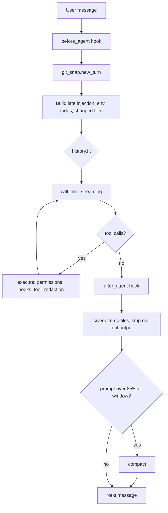

# CodeHarness

A small, readable terminal coding agent for Windows. It runs a tool-calling loop against any OpenAI-compatible chat API, and is built around one idea: **spend the context window deliberately**. Tool output is capped, old results are shrunk, exploration is delegated to throwaway subagents, and when the window finally fills, the transcript is compacted into a handoff note, all arranged so the cached prompt prefix stays byte-identical for as long as possible.

```
> add a --verbose flag to the CLI and update the docs

  todos 1/3
  [x] Find where CLI args are parsed
  [~] Add the flag
  [ ] Update README

  agent
  Added `--verbose` in cli.py and documented it.
```

## Features

- **Streaming agent loop** with tool calling, a live spinner, and per-request token usage.
- **Cache-friendly context management**: late injection, tool-output capping, stubbing, last-resort dropping, and LLM-written compaction.
- **Subagents** (`task` tool) that explore the codebase in their own context window and return only a short report.
- **Repo map**: a tree-sitter + PageRank ranked outline of classes and functions (adapted from the approach used by Aider).
- **Permission layer** that auto-allows read-only commands, asks about unknown ones, and hard-denies dangerous ones.
- **Windows sandbox** (ACLs, Job Object, poisoned network environment) around every shell command.
- **Secret redaction** on tool results and on hook environments.
- **Undo** via per-turn git snapshots, plus **rewind**, **resume**, and **session browser**.
- **Persistent memory** (`AGENTS.md`) and **skills** (`SKILL.md` folders) loaded into the system prompt.
- **Lifecycle hooks** defined in YAML that run your commands before/after turns and tool calls.
- **Planning**: a `write_todos` checklist that is re-injected every turn so the plan lives outside the transcript.
- **Web search** through Exa.

## Requirements

- **Windows** with Windows PowerShell 5.1 (`powershell.exe`). The shell tool and sandbox only run on Windows.
- **Python 3.10+** (the code uses `X | None` type syntax).
- **git** on `PATH` (used for undo snapshots, change detection, and file discovery).
- An API key for an **OpenAI-compatible** endpoint.
- Optional: an [Exa](https://exa.ai) API key for web search.

## Installation

```powershell
git clone <your-repo-url>
cd <your-repo>
python -m venv .venv
.venv\Scripts\Activate.ps1
pip install -r requirements.txt
```

The modules use relative imports, so they must live inside a package directory (this README assumes it is called `codeharness/`) and be launched with `-m`. `repomap.py` also expects its tree-sitter tag queries in a `queries/` folder next to it (see [Project layout](#project-layout)).

## Configuration

Settings are read from real environment variables first, then from `~/.agents/env` (one `KEY=value` per line, `#` for comments). Real environment variables win.

```ini
# ~/.agents/env
BASE_URL=https://openrouter.ai/api/v1
API_KEY=sk-or-v1-...
MODEL=deepseek/deepseek-v4-flash
CONTEXT_WINDOW=128000
EXA_API_KEY=...
```

| Variable | Required | Default | Purpose |
|---|---|---|---|
| `BASE_URL` | yes | none | Base URL of the OpenAI-compatible API |
| `API_KEY` | yes | none | API key for that endpoint |
| `MODEL` | no | `deepseek/deepseek-v4-flash` | Model name sent with every request |
| `CONTEXT_WINDOW` | no | `128000` | Model's context size in tokens; drives capping and compaction |
| `EXA_API_KEY` | for `web_search` | none | Exa API key; without it the tool returns an error the model can read |

Compaction thresholds are constants in `config.py`: `COMPACT_AT = 0.85` and `COMPACT_TO = 0.35`.

## Usage

Run it **from the project you want the agent to work on**. The working directory is the sandbox root, the memory location, the snapshot target, and the session key.

```powershell
# with the package's parent directory on PYTHONPATH
$env:PYTHONPATH = "C:\path\to\parent-of-codeharness"
python -m codeharness.agent             # new chat
python -m codeharness.agent --resume    # continue the most recent chat in this project
python -m codeharness.agent --debug     # also print each raw model message
```

- **Alt+Enter** inserts a newline; **Enter** sends.
- An empty message, **Ctrl+D**, or **Ctrl+Z** exits and prints a token-usage summary.
- Input history is kept in `~/.agents/history`.

### Slash commands

| Command | What it does |
|---|---|
| `/undo [turn]` | Restore the working tree to the snapshot taken before the agent's first write in that turn (default: the latest) |
| `/rewind` | Pick an earlier message and cut the chat back to it |
| `/sessions` | Browse and open past chats for this project |
| `/compact` | Summarise old history now and free up context |
| `/map [path]` | Print the repo map for a directory (default `.`) |
| `/memory` (or `/agents`) | Show the project memory in `AGENTS.md` |

Any other `/...` input prints this list.

## How it works



Each user message starts a **turn**. Inside a turn the agent calls the model, runs any tools it asked for, feeds the results back, and repeats until the model answers without requesting a tool.

### Tools

| Tool | Description |
|---|---|
| `powershell` | Run a command in the sandbox (60 s timeout); output is capped |
| `read_file` | Read a file; output is capped |
| `write_file` | Create or overwrite a file; returns a diff when overwriting; snapshots first |
| `str_replace` | Replace exact text that must match once (or all matches with `allow_multi_edit`); returns a diff |
| `write_todos` | Replace the plan; at most one task may be `in_progress` |
| `task` | Run a read-only subagent on a standalone question and get back its report |
| `repo_map` | Ranked structural map of the repo, optionally focused on given files |
| `web_search` | Exa search returning titles, URLs, and highlights |
| `read_skill` | Load a skill's full instructions |
| `remember` | Append a fact to `AGENTS.md` |

Malformed tool calls (bad JSON, unknown tool, wrong arguments) and tool exceptions are returned to the model as ordinary results so it can retry; they never end the session.

### Context management

The main constraint is the prompt cache, so each mechanism avoids editing the stable prefix.

| Stage | Where | What it does |
|---|---|---|
| **Late injection** | `context.py` | Time, git branch, the todo list, and "these files changed since your last turn" are appended at the *end* of each request and are not saved to the transcript |
| **Cap** | `history.cap` | A fresh tool result over 10,000 characters is trimmed; the full text is parked in a temp file the agent can page through for the rest of the turn |
| **Strip** | `history.strip` | When a turn ends, its tool results shrink to a 300-character stub; the edit lands at the tail so the prefix stays cached |
| **Drop** | `history.fit` | If one request is still too large, whole tool results are discarded oldest-first until it fits |
| **Compact** | `compact.py` | Once the prompt passes 85% of the window, a tool-less summariser call writes a handoff note (goal, what happened, files, state, next); the transcript becomes `system + summary + recent tail` (about 35% of the window) |

`history.locked()` finds the newest `<summary>` and treats everything up to it as frozen, so cap/strip/drop never touch it. Compaction only cuts at points that cannot orphan a tool result from its tool call.

### Subagents

`task` spawns a fresh loop with its own two-message history. The subagent:

1. starts with no memory of the main conversation,
2. cannot call `task`, `write_todos`, `write_file`, `str_replace`, or `remember` (they are simply not in its tool list),
3. runs the same loop and the same `execute` path, so the same permissions and sandbox apply,
4. returns only its final message, which is asked to be under about 150 words,
5. is limited to 12 turns, after which it returns whatever partial findings it has.

The result is that exploring tens of thousands of tokens of code costs the main context only one short answer.

### Repo map

`repomap.py` parses source files with tree-sitter, extracts definitions and references, builds a file graph, ranks it with PageRank (optionally biased toward files you name), and renders the highest-ranked lines to fit a token budget. Tags are cached with `diskcache` in `.tags.cache.v4` (or `.v3`) under the mapped root. File discovery uses `git ls-files`, falling back to a directory walk that skips common build and cache directories.

You can also run it standalone:

```powershell
python -m codeharness.repomap            # map the current directory
python -m codeharness.repomap src\       # map a subfolder
python -m codeharness.repomap a.py src\  # focus on a.py, map src\
```

## Safety

Three independent layers sit around tool execution.

### Permissions (`permissions.py`)

Every `powershell` command is split on `&&`, `||`, `;`, and `|`. Each part is matched against glob rules (the **last matching rule wins**; unmatched commands default to `ask`) and the **strictest verdict across all parts** is applied.

- **allow** (runs silently): `Get-ChildItem`, `Get-Content`, `Get-Item`, `Get-Command`, `Select-String`, `Select-Object`, `Sort-Object`, `Get-Location`, `Set-Location`, `Write-Output`, `Get-Date`, `rg`, `tree`, `git status/diff/log/show/ls-files`, `pytest`, `python -m pytest`
- **deny** (blocked even if you say yes): `Remove-Item`, `sudo`, `Set-Acl`, `takeown`, `Invoke-WebRequest`, `curl`, `wget`, `git push`, `git reset`, `git clean`
- **ask** (prompts `y/n`): everything else, plus `write_file` / `str_replace` on paths outside the project

Edit `POWERSHELL_RULES` to tune this.

### Sandbox (`sandbox.py`)

Each command runs in a fresh `powershell.exe` (`-NoProfile -NonInteractive`) with:

- an **ACL layer** that grants the project directory to a synthetic per-project SID and adds deny-write ACEs on `.git`, `.agents`, `.codex`, `.aws`, and `.env`,
- a **Job Object** with `KILL_ON_JOB_CLOSE`, so no child process outlives the call,
- a **poisoned environment**: dead proxy variables, blocked git transports, offline pip/npm/cargo flags, `TEMP`/`TMP` redirected to `.agents/tmp`, and pagers disabled to avoid hangs.

### Redaction (`redaction.py`)

Tool results are scrubbed before they enter the transcript, and tool arguments are scrubbed before they reach hook environments. Patterns cover private key blocks, OpenRouter / Anthropic / OpenAI-style keys, GitHub tokens, JWTs, and generic `API_KEY` / `TOKEN` / `SECRET` / `PASSWORD` / `AUTHORIZATION` assignments. A note is shown in the UI when something was redacted.

## Persistence

### Sessions

One JSONL file per chat at `~/.agents/sessions/<project-path>/<timestamp>.jsonl`. Files are append-only: a rewind is recorded as a `{"rewind_to": n}` entry and a compaction as a `{"compacted": [...]}` entry, so history is never rewritten. Half-written trailing lines (for example after a kill) are skipped on load.

### Memory (`AGENTS.md`)

The first of `AGENTS.md`, `.agents/AGENTS.md`, `.agents/memory.md` found in the project is loaded into the system prompt, followed by global rules from `~/.agents/AGENTS.md` or `~/.agents/rules.md`. The model can append lines with the `remember` tool (under `## Key Learnings & Conventions`, de-duplicated).

### Undo (`git_snap.py`)

Before the first `write_file` / `str_replace` of each turn, the working tree (including untracked files) is saved with `git stash push --include-untracked -m codeharness:turn-N` and immediately re-applied, so nothing visibly changes. `/undo` discards the current working-tree changes (`git checkout -- .` and `git clean -fd`), applies the snapshot, and drops the stash entry. Outside a git repository, undo is unavailable.

## Extending

### Skills

A skill is a folder containing a `SKILL.md` with YAML frontmatter:

```markdown
---
name: release-notes
description: Draft release notes from the git log in our house style.
---
Step-by-step instructions the agent follows after calling read_skill...
```

Skills are discovered in `<project>\.agents\skills\*\SKILL.md` and `~\.agents\skills\*\SKILL.md`. Names and descriptions go into the system prompt; the agent calls `read_skill` to load the full text when one matches.

### Hooks

Define hooks in `~/.agents/hooks.yaml`:

```yaml
- name: lint-on-edit
  trigger: after_tool        # before_agent | after_agent | before_tool | after_tool | on_error
  command: powershell -c "if ($env:CODEHARNESS_TOOL_NAME -eq 'write_file') { ruff check . }"
  timeout_sec: 30            # default 30
  fail_closed: false         # if true, a hook that raises aborts the operation
  enabled: true
```

Commands run through the shell in the project directory and receive context as environment variables:

| Variable | Set for |
|---|---|
| `CODEHARNESS_TRIGGER`, `CODEHARNESS_CWD` | every hook |
| `CODEHARNESS_USER_MESSAGE` | `before_agent`, `after_agent` |
| `CODEHARNESS_RESPONSE` (first 4,000 chars) | `after_agent` |
| `CODEHARNESS_TOOL_NAME`, `CODEHARNESS_TOOL_ARGS` (JSON, redacted) | `before_tool`, `after_tool` |
| `CODEHARNESS_TOOL_RESULT` (first 4,000 chars) | `after_tool` |
| `CODEHARNESS_ERROR` | `on_error` |

### Adding a tool

1. Write a function in `tools.py` and add its JSON schema to `TOOL_SCHEMAS`.
2. Register it in the `TOOLS` dict.
3. If it is risky, add a rule in `permissions.check`.
4. If subagents must not have it, add its name to `WITHHELD` in `subagent.py`.

## Project layout

```
codeharness/
├── agent.py          # entry point and main loop
├── llm.py            # system prompt, OpenAI client, streaming call_llm
├── config.py         # env + ~/.agents/env settings
├── tools.py          # tool implementations, schemas, execute()
├── subagent.py       # `task` tool: isolated read-only exploration loop
├── todos.py          # write_todos and the plan state
├── skills.py         # SKILL.md discovery and read_skill
├── memory.py         # AGENTS.md read/append and prompt block
├── web_search.py     # Exa search tool
├── repomap.py        # tree-sitter + PageRank repo map
├── queries/          # tree-sitter tag queries (*.scm) used by repomap.py
├── context.py        # late injection: env, todos, changed files
├── history.py        # cap, strip, drop
├── compact.py        # LLM compaction into a handoff note
├── session.py        # JSONL transcripts, rewind, resume
├── git_snap.py       # per-turn snapshots for /undo
├── permissions.py    # allow / ask / deny rules
├── sandbox.py        # Windows ACL + Job Object sandbox
├── redaction.py      # secret scrubbing
├── hooks.py          # YAML lifecycle hooks
├── commands.py       # slash commands
├── prompt.py         # prompt_toolkit input line
├── ui.py             # rich terminal output
└── requirements.txt
```

Files created at runtime: `~/.agents/{env,hooks.yaml,history,sessions/,skills/,AGENTS.md}`, and inside the project `.agents/tmp/` (sandbox temp), `.tags.cache.v*/` (repo-map cache), and `AGENTS.md` (once something is remembered). You will probably want to git-ignore the first two.

## Known limitations

- **Windows only.** `sandbox.run` raises on other platforms, and the shell tool is PowerShell.
- **The sandbox is a set of guardrails, not isolation.** Its own docstring notes that network blocking and write restriction outside the project are not enforced. The network environment variables are advisory, and the ACL rules use a synthetic SID, so they only bind a process whose token carries that SID. Rely on the permission layer, the deny list, and reviewing `ask` prompts, and run untrusted work in a VM or container.
- **`read_file` is not permission-gated** and can read any path the current user can.
- **Hook exit codes are ignored.** `fail_closed` only takes effect when launching the hook raises an exception, not when the command exits non-zero. The `on_error` trigger is implemented in `hooks.py` but is not currently called from the agent loop.
- **`/undo` is destructive** to uncommitted changes made after the snapshot, and snapshot stash entries remain in `git stash list` until they are undone.
- **Redaction is pattern-based** and will not catch every secret format; model-written tool arguments in the transcript are not redacted.
- **Token estimates** for capping and dropping are rough (characters divided by four); compaction itself triggers on the provider's reported prompt tokens.
